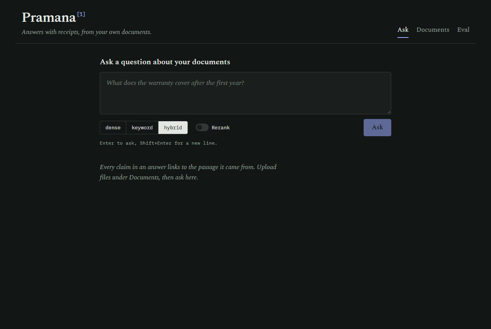
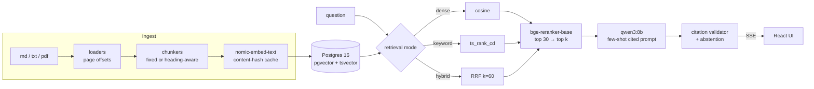

# Pramana

**A fully local, cited RAG assistant whose retrieval quality is measured, not guessed.**



*Pramana* (Sanskrit: "valid means of knowledge, proof") answers questions about a document collection and
cites the exact passage behind every claim; click a citation and the source opens with the cited span highlighted.
Everything runs on one laptop GPU (RTX 4060, 8 GB): Postgres + pgvector, Ollama with one LLM (qwen3:8b), a cross-encoder reranker.
Each design choice (chunk size, overlap, dense vs keyword vs hybrid retrieval, reranking) was picked with an eval
harness: __QSET__ questions over the pinned FastAPI docs, __NRUNS__ retrieval configurations, and full answer-quality
runs on the best one. All numbers below come from `eval/results/`.

## Quickstart

Needs Docker, Ollama, Python 3.11+, Node 20+, GNU make (Linux, macOS or WSL).

```bash
git clone <this repo> pramana && cd pramana
ollama pull nomic-embed-text && ollama pull qwen3:8b
make ingest   # starts Postgres (docker compose), installs deps, migrates, fetches the pinned docs, embeds
make eval     # optional: re-runs the grid (results are committed; cached runs are skipped)
make dev      # API on :8000, UI on http://localhost:5173
```

`qwen3:8b` is the only LLM: it writes answers, drafted the eval questions and judges faithfulness. Copy `.env.example` to `.env` to
change models or ports. On Windows, use `127.0.0.1` rather than `localhost` in URLs: `localhost` resolves to IPv6
first and costs ~2 s per request (this was measured: it made the first ingestion attempt 10x slower).

## Architecture



- **Chunks keep char offsets** into the original text, so a citation maps to an exact highlightable span, and several
  chunkings coexist in one table (`chunks.config`).
- **Gold labels are evidence spans, not chunk ids**, so one question set scores every chunk size fairly: a chunk counts
  as a hit when it overlaps the gold span by at least half of the shorter of the two.
- **Citations are validated**: markers that don't map to a retrieved chunk are stripped and counted.
- **Abstention**: the model is shown an example of replying `NOT_FOUND`; a calibrated reranker-score floor also skips
  the LLM when nothing relevant was retrieved.

## Results

__RESULTS__

## Limitations

- **The question set is LLM-drafted.** Questions and gold spans were drafted by `qwen3:8b` from sampled chunks (each
  gold span verified to be a verbatim quote of its passage; 246 drafts were discarded because the quote was not
  verbatim or the paraphrase was not measurably keyword-poor).
  A random 30% is listed in `eval/REVIEW_CHECKLIST.md` for manual review, **not yet done**. Some questions are
  awkward or generic.
- **Unanswerable questions were hand-written** (15), each checked by grep to be absent from the corpus. They are
  out-of-scope topics, which is easier than near-miss questions.
- **The faithfulness judge is the same model that writes the answers** (qwen3:8b), so it may be lenient toward
  its own style. Its agreement with a human is __AGREEMENT__.
- **Small corpus, one domain**: 156 markdown pages from one project. Release notes are included and sometimes win
  retrieval over the tutorial page that explains the same thing.
- **Answer-quality metrics cover 3 runs, not the grid.** Generation is ~100x slower than retrieval on this GPU.
- **Thresholds are calibrated on the same questions they're evaluated on** (5th percentile of answerable top scores).
- Token counts are a regex approximation; dense search is an exact scan (fine at this size, no ANN index); the rate
  limiter is in-memory and single-process.

## Security notes

Pramana is a local, single-user tool: the API has no authentication and binds to `127.0.0.1`, Postgres is
published on `127.0.0.1` only with a development password, and CORS allows only the local UI. Don't expose it
to a network as-is. Uploaded files are parsed in memory and never written to disk.

## Credits

The evaluation corpus and the passages quoted in `eval/questions.jsonl` come from the
[FastAPI documentation](https://github.com/fastapi/fastapi) (MIT License, © Sebastián Ramírez), pinned to commit
`45cb225`.

## Project layout

```
backend/app/{api,ingest,retrieval,generation,db,core}   FastAPI app (api lives in app/main.py)
backend/tests/                                          pytest: chunkers, retrieval, citations, API
eval/                                                   questions, harness, metrics, results, report
frontend/                                               React + TypeScript + Vite
docs/DEMO.md                                            90-second demo script
```

## Level up

1. **Multi-hop questions** across pages (current multi-chunk questions stay within one page).
2. **PDF tables**: `pypdf` flattens tables to text; a layout-aware extractor would keep rows together.
3. **A feedback button that grows the eval set**: thumbs-down on an answer saves the question plus the passage the
   user says was right as a new gold row, so the benchmark tracks real failures.

## License

MIT, see [LICENSE](LICENSE).
