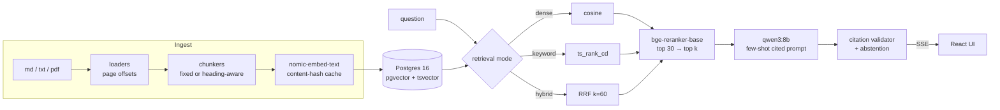
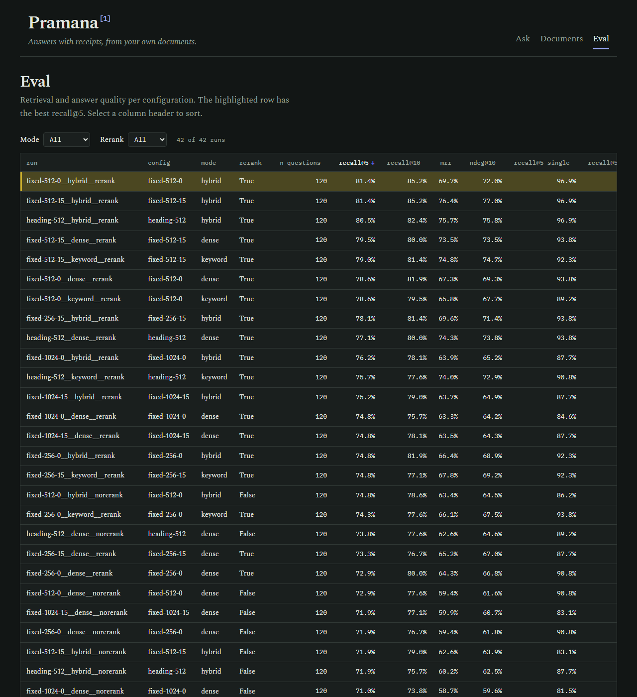
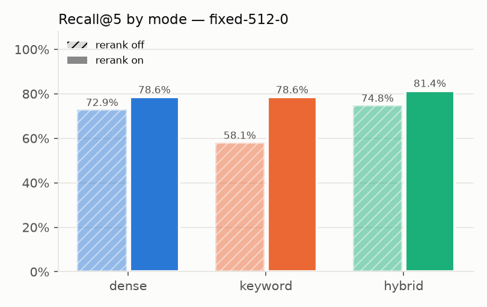
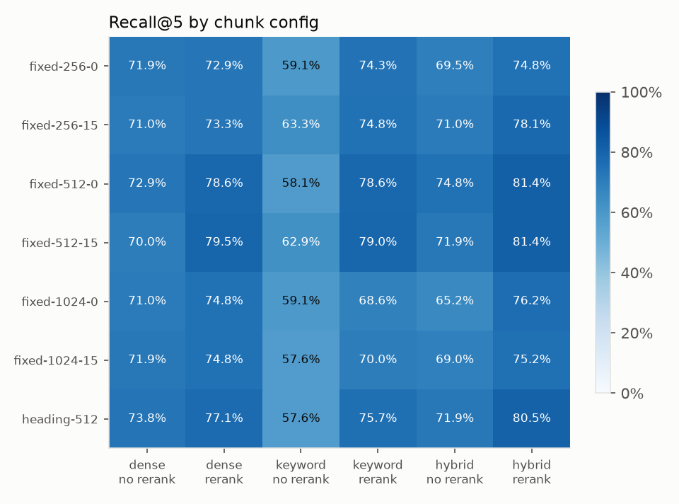

# Pramana

**A fully local, cited RAG assistant whose retrieval quality is measured, not guessed.**


*Pramana* (Sanskrit: "valid means of knowledge, proof") answers questions about a document collection and
cites the exact passage behind every claim; click a citation and the source opens with the cited span highlighted.
Everything runs on one laptop GPU (RTX 4060, 8 GB): Postgres + pgvector, Ollama with one LLM (qwen3:8b), a cross-encoder reranker.
Each design choice (chunk size, overlap, dense vs keyword vs hybrid retrieval, reranking) was picked with an eval
harness: 120 questions over the pinned FastAPI docs, 42 retrieval configurations, and full answer-quality
runs on the best one. All numbers below come from `eval/results/`.

## Quickstart

Needs Docker, Ollama, Python 3.11+, Node 20+, GNU make (Linux, macOS or WSL).

```bash
git clone <this repo> pramana && cd pramana
ollama pull nomic-embed-text && ollama pull qwen3:8b
make ingest   # starts Postgres (docker compose), installs deps, migrates, fetches the pinned docs, embeds
make eval     # optional: re-runs the grid (results are committed; cached runs are skipped)
make dev      # API on :8000, UI on http://localhost:5173
```

`qwen3:8b` is the only LLM: it writes answers, drafted the eval questions and judges faithfulness. Copy `.env.example` to `.env` to
change models or ports. On Windows, use `127.0.0.1` rather than `localhost` in URLs: `localhost` resolves to IPv6
first and costs ~2 s per request (this was measured: it made the first ingestion attempt 10x slower).

## Architecture



- **Chunks keep char offsets** into the original text, so a citation maps to an exact highlightable span, and several
  chunkings coexist in one table (`chunks.config`).
- **Gold labels are evidence spans, not chunk ids**, so one question set scores every chunk size fairly: a chunk counts
  as a hit when it overlaps the gold span by at least half of the shorter of the two.
- **Citations are validated**: markers that don't map to a retrieved chunk are stripped and counted.
- **Abstention**: the model is shown an example of replying `NOT_FOUND`; a calibrated reranker-score floor also skips
  the LLM when nothing relevant was retrieved.

## Results

All numbers come from `eval/results/summary.csv` (one row per run, built from `eval/results/runs/*.json`).
Full tables: [`eval/results/report.md`](eval/results/report.md). Eval set: 120 questions (65 single-chunk,
20 multi-chunk, 20 paraphrased/keyword-poor, 15 unanswerable) over the FastAPI docs at commit `45cb225`.



### Retrieval: 42 configurations

Chunk size {256, 512, 1024} x overlap {0, 15%} x mode {dense, keyword, hybrid} x rerank {off, on}, plus a
heading-aware 512 chunker. Recall@5 = share of gold evidence spans found in the top 5 chunks.

| Config (512 tokens, no overlap) | recall@5 | recall@10 | MRR | nDCG@10 | retrieval p50 |
|---|---|---|---|---|---|
| dense (baseline) | 72.9% | 77.6% | 59.4% | 61.6% | 257 ms |
| keyword | 58.1% | 70.5% | 48.8% | 51.7% | 18 ms |
| hybrid (RRF) | 74.8% | 78.6% | 63.4% | 64.5% | 270 ms |
| dense + rerank | 78.6% | 81.9% | 67.3% | 69.3% | 670 ms |
| keyword + rerank | 78.6% | 79.5% | 65.8% | 67.7% | 499 ms |
| **hybrid + rerank (chosen)** | **81.4%** | **85.2%** | **69.7%** | **72.0%** | 681 ms |




### Answers: 3 runs at the chosen chunk config (judge: qwen3:8b)

| Run | citation precision | faithfulness | abstention (15 unanswerable) | false abstention (105 answerable) | answer p50 / p95 |
|---|---|---|---|---|---|
| dense | 54.0% | 63.6% | 100% | 5.7% | 4.1 s / 7.7 s |
| hybrid | 55.4% | 61.8% | 100% | 2.9% | 4.7 s / 9.4 s |
| **hybrid + rerank** | **57.7%** | **66.7%** | **100%** | 5.7% | 9.0 s / 10.6 s |

Every non-abstained answer carried at least one citation, and no run produced an invalid citation marker.
Faithfulness for hybrid + rerank is over the 99 answers the judge scored.

### What I learned / what surprised me

- **Reranking was the biggest lever, not hybrid search.** At 512 tokens the cross-encoder lifted keyword search
  from 58.1% to 78.6% recall@5 and dense from 72.9% to 78.6%. Hybrid alone added only 1.9 points over dense.
- **Hybrid without reranking can be worse than dense.** At 1024-token chunks hybrid scored 65.2% vs dense 71.0%:
  RRF gives the weak keyword list equal say. After reranking, hybrid was the best mode at every chunk size.
- **Chunk size trades single-passage for multi-passage questions.** 256-token chunks reached 93.9% on single-chunk
  questions but at most 77.5% on multi-chunk ones; 1024 reached 90.0% on multi-chunk but at most 87.7% on single.
  512 balanced both (96.9% / 82.5% with hybrid + rerank).
- **Overlap barely moved recall@5.** 512 with 15% overlap tied the winner at 81.4% (and had a better MRR, 76.4% vs
  69.7%); the selection rule was fixed as "highest recall@5" before the run, so the tie went to the first config.
- **Paraphrased questions were the weak spot everywhere:** 10–35% recall@5 in every run, including dense. Part of
  this is the eval set itself (some LLM rewrites drifted from the original meaning), so treat it as a lower bound.
- **Better retrieval gave modestly better answers:** +3.7 points citation precision and +3.0 faithfulness,
  while median answer latency roughly doubled (4.1 s to 9.0 s).

### Resume line (filled from measured values only)

> Built a fully local, cited RAG assistant over 156 documents; raised retrieval recall@5 from 72.9% to 81.4% with
> hybrid search and re-ranking, evaluated on a 120-question set with 100% abstention accuracy.

| Value | Source |
|---|---|
| 156 documents | `eval/corpus_manifest.json` → `file_count` |
| 72.9% | `eval/results/summary.csv`, run `fixed-512-0__dense__norerank`, `recall@5` = 0.7286 |
| 81.4% | `eval/results/summary.csv`, run `fixed-512-0__hybrid__rerank`, `recall@5` = 0.8143 |
| 120 questions | `eval/questions.jsonl` (also `n_questions` in `summary.csv`) |
| 100% abstention | `eval/results/summary.csv`, run `fixed-512-0__hybrid__rerank`, `abstention_accuracy` = 1.0 (15 of 15) |

## Limitations

- **The question set is LLM-drafted.** Questions and gold spans were drafted by `qwen3:8b` from sampled chunks (each
  gold span verified to be a verbatim quote of its passage; 246 drafts were discarded because the quote was not
  verbatim or the paraphrase was not measurably keyword-poor).
  A random 30% is listed in `eval/REVIEW_CHECKLIST.md` for manual review, **not yet done**. Some questions are
  awkward or generic.
- **Unanswerable questions were hand-written** (15), each checked by grep to be absent from the corpus. They are
  out-of-scope topics, which is easier than near-miss questions.
- **The faithfulness judge is the same model that writes the answers** (qwen3:8b), so it may be lenient toward
  its own style. Its agreement with a human is not measured yet: 20 judged answers in `eval/results/judge_spotcheck.jsonl` await a
  human label (`human_faithful`), after which `eval/report.py` reports agreement.
- **Small corpus, one domain**: 156 markdown pages from one project. Release notes are included and sometimes win
  retrieval over the tutorial page that explains the same thing.
- **Answer-quality metrics cover 3 runs, not the grid.** Generation is ~100x slower than retrieval on this GPU.
- **Thresholds are calibrated on the same questions they're evaluated on** (5th percentile of answerable top scores).
- **Abstention was tested on only 15 questions**, all clearly off-topic; 100% there says little about
  near-miss questions. The calibrated reranker floor (0.352) also wrongly abstains on 5.7% of answerable ones.
- **Reranking roughly doubles first-token latency** (3.5 s to 7.9 s p50). Rerank itself is ~0.4 s; the rest is
  probably the reranker and qwen3:8b competing for 8 GB of VRAM (not isolated).
- Token counts are a regex approximation; dense search is an exact scan (fine at this size, no ANN index); the rate
  limiter is in-memory and single-process.

## Security notes

Pramana is a local, single-user tool: the API has no authentication and binds to `127.0.0.1`, Postgres is
published on `127.0.0.1` only with a development password, and CORS allows only the local UI. Don't expose it
to a network as-is. Uploaded files are parsed in memory and never written to disk.

## Credits

The evaluation corpus and the passages quoted in `eval/questions.jsonl` come from the
[FastAPI documentation](https://github.com/fastapi/fastapi) (MIT License, © Sebastián Ramírez), pinned to commit
`45cb225`.

## Project layout

```
backend/app/{api,ingest,retrieval,generation,db,core}   FastAPI app (api lives in app/main.py)
backend/tests/                                          pytest: chunkers, retrieval, citations, API
eval/                                                   questions, harness, metrics, results, report
frontend/                                               React + TypeScript + Vite
docs/DEMO.md                                            90-second demo script
```

## Level up

1. **Multi-hop questions** across pages (current multi-chunk questions stay within one page).
2. **PDF tables**: `pypdf` flattens tables to text; a layout-aware extractor would keep rows together.
3. **A feedback button that grows the eval set**: thumbs-down on an answer saves the question plus the passage the
   user says was right as a new gold row, so the benchmark tracks real failures.

## License

MIT, see [LICENSE](LICENSE).
