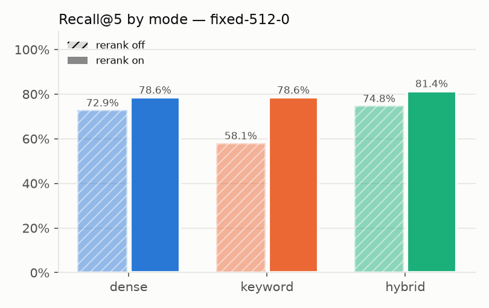
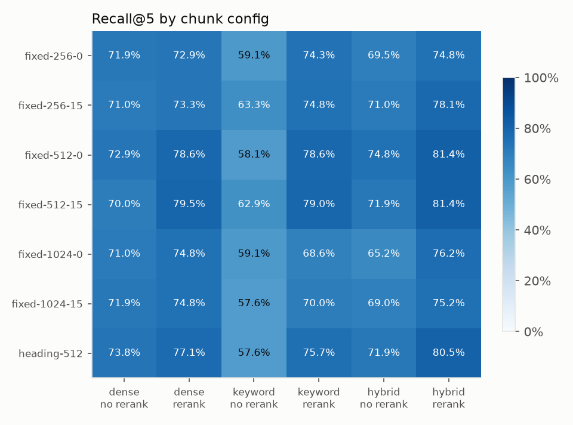
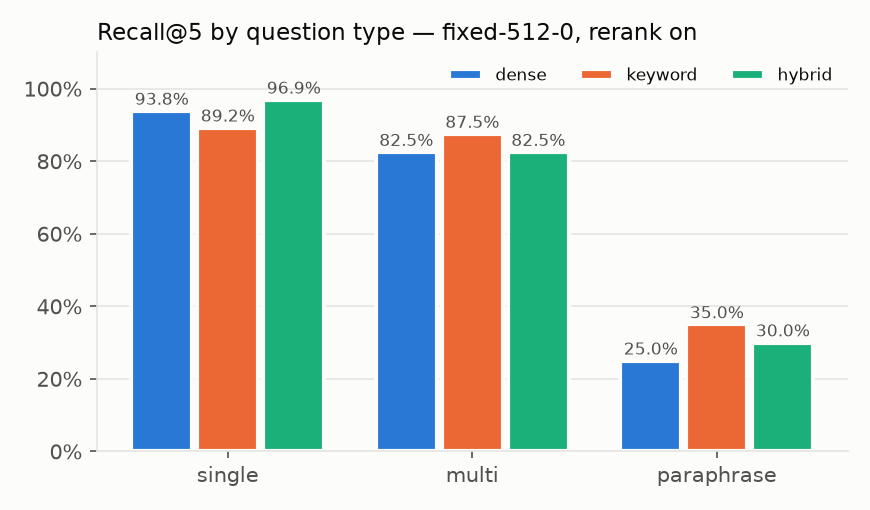
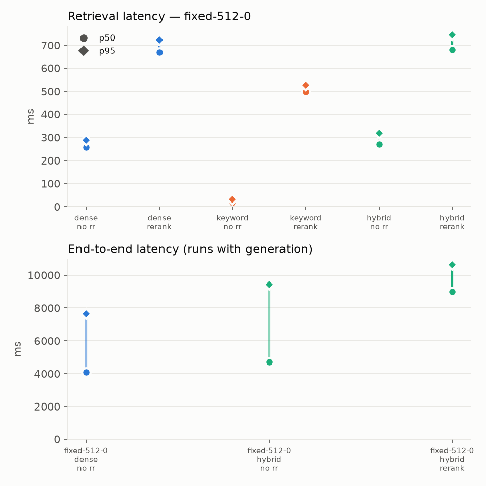

# Pramana retrieval eval

Corpus: https://github.com/fastapi/fastapi @ `45cb2252c737`, `docs/en/docs`, 156 files.

Runs in summary: 42 of 42.

## Question set

| Type | Count |
|---|---|
| single | 65 |
| multi | 20 |
| paraphrase | 20 |
| unanswerable | 15 |
| total | 120 |

## Best run

Highest recall@5: **fixed-512-0 / hybrid / rerank**.

| Run | n | recall@5 | recall@10 | mrr | ndcg@10 | recall@5_single | recall@5_multi | recall@5_paraphrase | p50 ms | p95 ms |
|---|---|---|---|---|---|---|---|---|---|---|
| fixed-512-0 / hybrid / rerank | 120 | 81.4% | 85.2% | 69.7% | 72.0% | 96.9% | 82.5% | 30.0% | 681 | 744 |

## Charts

Recall@5 per mode at the best config, rerank off vs on.

Recall@5 per chunk config and mode/rerank.

Recall@5 per question type at the best config, rerank on.

Latency p50/p95.

## Top 10 runs by recall@5

| Run | n | recall@5 | recall@10 | mrr | ndcg@10 | recall@5_single | recall@5_multi | recall@5_paraphrase | p50 ms | p95 ms |
|---|---|---|---|---|---|---|---|---|---|---|
| fixed-512-0 / hybrid / rerank | 120 | 81.4% | 85.2% | 69.7% | 72.0% | 96.9% | 82.5% | 30.0% | 681 | 744 |
| fixed-512-15 / hybrid / rerank | 120 | 81.4% | 85.2% | 76.4% | 77.0% | 96.9% | 82.5% | 30.0% | 680 | 718 |
| heading-512 / hybrid / rerank | 120 | 80.5% | 82.4% | 75.7% | 75.8% | 96.9% | 82.5% | 25.0% | 772 | 846 |
| fixed-512-15 / dense / rerank | 120 | 79.5% | 80.0% | 73.5% | 73.5% | 93.8% | 87.5% | 25.0% | 670 | 788 |
| fixed-512-15 / keyword / rerank | 120 | 79.0% | 81.4% | 74.8% | 74.7% | 92.3% | 85.0% | 30.0% | 506 | 527 |
| fixed-512-0 / dense / rerank | 120 | 78.6% | 81.9% | 67.3% | 69.2% | 93.8% | 82.5% | 25.0% | 670 | 723 |
| fixed-512-0 / keyword / rerank | 120 | 78.6% | 79.5% | 65.8% | 67.7% | 89.2% | 87.5% | 35.0% | 499 | 526 |
| fixed-256-15 / hybrid / rerank | 120 | 78.1% | 81.4% | 69.6% | 71.4% | 93.8% | 75.0% | 30.0% | 552 | 608 |
| heading-512 / dense / rerank | 120 | 77.1% | 80.0% | 74.3% | 73.8% | 93.8% | 80.0% | 20.0% | 825 | 862 |
| fixed-1024-0 / hybrid / rerank | 120 | 76.2% | 78.1% | 63.9% | 65.2% | 87.7% | 90.0% | 25.0% | 672 | 715 |

## All runs

| Run | n | recall@5 | recall@10 | mrr | ndcg@10 | recall@5_single | recall@5_multi | recall@5_paraphrase | p50 ms | p95 ms |
|---|---|---|---|---|---|---|---|---|---|---|
| fixed-256-0 / dense / no rerank | 120 | 71.9% | 76.7% | 59.4% | 61.8% | 90.8% | 62.5% | 20.0% | 263 | 302 |
| fixed-256-0 / dense / rerank | 120 | 72.9% | 80.0% | 64.3% | 66.8% | 90.8% | 62.5% | 25.0% | 545 | 779 |
| fixed-256-0 / keyword / no rerank | 120 | 59.1% | 66.7% | 44.5% | 48.8% | 75.4% | 55.0% | 10.0% | 18 | 34 |
| fixed-256-0 / keyword / rerank | 120 | 74.3% | 77.6% | 66.1% | 67.5% | 93.8% | 65.0% | 20.0% | 353 | 414 |
| fixed-256-0 / hybrid / no rerank | 120 | 69.5% | 76.7% | 63.1% | 64.7% | 86.2% | 70.0% | 15.0% | 289 | 336 |
| fixed-256-0 / hybrid / rerank | 120 | 74.8% | 81.9% | 66.4% | 68.9% | 92.3% | 62.5% | 30.0% | 573 | 642 |
| fixed-256-15 / dense / no rerank | 120 | 71.0% | 76.2% | 60.4% | 62.9% | 84.6% | 72.5% | 25.0% | 283 | 335 |
| fixed-256-15 / dense / rerank | 120 | 73.3% | 76.7% | 65.2% | 67.0% | 87.7% | 70.0% | 30.0% | 591 | 641 |
| fixed-256-15 / keyword / no rerank | 120 | 63.3% | 70.0% | 51.1% | 54.1% | 78.5% | 62.5% | 15.0% | 19 | 38 |
| fixed-256-15 / keyword / rerank | 120 | 74.8% | 77.1% | 67.8% | 69.2% | 92.3% | 77.5% | 15.0% | 360 | 405 |
| fixed-256-15 / hybrid / no rerank | 120 | 71.0% | 77.6% | 63.4% | 65.0% | 87.7% | 72.5% | 15.0% | 280 | 331 |
| fixed-256-15 / hybrid / rerank | 120 | 78.1% | 81.4% | 69.6% | 71.4% | 93.8% | 75.0% | 30.0% | 552 | 608 |
| fixed-512-0 / dense / no rerank | 120 | 72.9% | 77.6% | 59.4% | 61.6% | 90.8% | 62.5% | 25.0% | 257 | 287 |
| fixed-512-0 / dense / rerank | 120 | 78.6% | 81.9% | 67.3% | 69.2% | 93.8% | 82.5% | 25.0% | 670 | 723 |
| fixed-512-0 / keyword / no rerank | 120 | 58.1% | 70.5% | 48.8% | 51.7% | 69.2% | 65.0% | 15.0% | 18 | 31 |
| fixed-512-0 / keyword / rerank | 120 | 78.6% | 79.5% | 65.8% | 67.7% | 89.2% | 87.5% | 35.0% | 499 | 526 |
| fixed-512-0 / hybrid / no rerank | 120 | 74.8% | 78.6% | 63.4% | 64.5% | 86.2% | 82.5% | 30.0% | 270 | 319 |
| fixed-512-0 / hybrid / rerank | 120 | 81.4% | 85.2% | 69.7% | 72.0% | 96.9% | 82.5% | 30.0% | 681 | 744 |
| fixed-512-15 / dense / no rerank | 120 | 70.0% | 78.6% | 58.7% | 61.0% | 83.1% | 72.5% | 25.0% | 252 | 307 |
| fixed-512-15 / dense / rerank | 120 | 79.5% | 80.0% | 73.5% | 73.5% | 93.8% | 87.5% | 25.0% | 670 | 788 |
| fixed-512-15 / keyword / no rerank | 120 | 62.9% | 68.6% | 48.2% | 51.1% | 72.3% | 75.0% | 20.0% | 15 | 27 |
| fixed-512-15 / keyword / rerank | 120 | 79.0% | 81.4% | 74.8% | 74.7% | 92.3% | 85.0% | 30.0% | 506 | 527 |
| fixed-512-15 / hybrid / no rerank | 120 | 71.9% | 79.0% | 62.6% | 63.9% | 83.1% | 82.5% | 25.0% | 269 | 298 |
| fixed-512-15 / hybrid / rerank | 120 | 81.4% | 85.2% | 76.4% | 77.0% | 96.9% | 82.5% | 30.0% | 680 | 718 |
| fixed-1024-0 / dense / no rerank | 120 | 71.0% | 73.8% | 58.7% | 59.6% | 81.5% | 77.5% | 30.0% | 247 | 269 |
| fixed-1024-0 / dense / rerank | 120 | 74.8% | 75.7% | 63.3% | 64.2% | 84.6% | 87.5% | 30.0% | 660 | 712 |
| fixed-1024-0 / keyword / no rerank | 120 | 59.1% | 67.6% | 50.9% | 51.1% | 66.1% | 75.0% | 20.0% | 10 | 17 |
| fixed-1024-0 / keyword / rerank | 120 | 68.6% | 73.3% | 61.7% | 61.6% | 76.9% | 85.0% | 25.0% | 492 | 515 |
| fixed-1024-0 / hybrid / no rerank | 120 | 65.2% | 74.8% | 60.0% | 59.2% | 73.9% | 82.5% | 20.0% | 256 | 283 |
| fixed-1024-0 / hybrid / rerank | 120 | 76.2% | 78.1% | 63.9% | 65.2% | 87.7% | 90.0% | 25.0% | 672 | 715 |
| fixed-1024-15 / dense / no rerank | 120 | 71.9% | 77.1% | 59.9% | 60.7% | 83.1% | 77.5% | 30.0% | 246 | 270 |
| fixed-1024-15 / dense / rerank | 120 | 74.8% | 78.1% | 63.5% | 64.3% | 87.7% | 87.5% | 20.0% | 666 | 792 |
| fixed-1024-15 / keyword / no rerank | 120 | 57.6% | 69.5% | 51.5% | 52.0% | 63.1% | 77.5% | 20.0% | 12 | 20 |
| fixed-1024-15 / keyword / rerank | 120 | 70.0% | 74.3% | 61.7% | 61.7% | 78.5% | 87.5% | 25.0% | 489 | 516 |
| fixed-1024-15 / hybrid / no rerank | 120 | 69.0% | 77.6% | 58.8% | 59.8% | 75.4% | 82.5% | 35.0% | 366 | 414 |
| fixed-1024-15 / hybrid / rerank | 120 | 75.2% | 79.0% | 63.7% | 64.9% | 87.7% | 90.0% | 20.0% | 795 | 1032 |
| heading-512 / dense / no rerank | 120 | 73.8% | 77.6% | 62.6% | 64.6% | 89.2% | 67.5% | 30.0% | 250 | 384 |
| heading-512 / dense / rerank | 120 | 77.1% | 80.0% | 74.3% | 73.8% | 93.8% | 80.0% | 20.0% | 825 | 862 |
| heading-512 / keyword / no rerank | 120 | 57.6% | 65.7% | 44.2% | 48.0% | 69.2% | 62.5% | 15.0% | 15 | 28 |
| heading-512 / keyword / rerank | 120 | 75.7% | 77.6% | 74.0% | 72.9% | 90.8% | 77.5% | 25.0% | 487 | 514 |
| heading-512 / hybrid / no rerank | 120 | 71.9% | 75.7% | 60.2% | 62.5% | 87.7% | 72.5% | 20.0% | 377 | 423 |
| heading-512 / hybrid / rerank | 120 | 80.5% | 82.4% | 75.7% | 75.8% | 96.9% | 82.5% | 25.0% | 772 | 846 |

## Generation

| Run | citation_precision | faithfulness | abstention_accuracy | false_abstention_rate | e2e_p50_ms | e2e_p95_ms | first_token_p50_ms | invalid markers |
|---|---|---|---|---|---|---|---|---|
| fixed-512-0 / dense / no rerank | 54.0% | 63.6% | 100.0% | 5.7% | 4082 | 7656 | 3482 | 0 |
| fixed-512-0 / hybrid / no rerank | 55.4% | 61.8% | 100.0% | 2.9% | 4712 | 9424 | 3810 | 0 |
| fixed-512-0 / hybrid / rerank | 57.7% | 66.7% | 100.0% | 5.7% | 9000 | 10646 | 7925 | 0 |

## Calibrated abstention thresholds

config `fixed-512-0`, dense `0.7002`, rerank `0.3523`

## Judge agreement (faithfulness spot-check)

[human labels] pending (20 rows to label).
